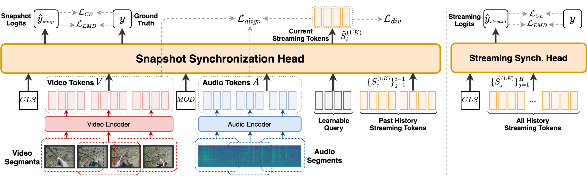
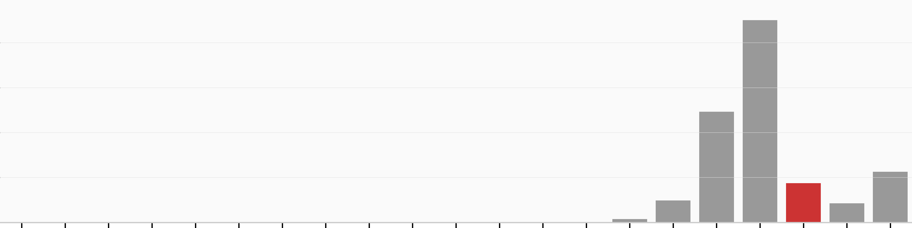
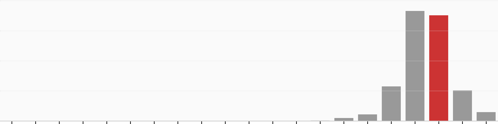

# AS-Synchformer

**Audio–visual synchronization for egocentric video with sparse synchronization events.**

Research code accompanying [Toward Robust Audio-Visual Synchronization Detection in Egocentric Video with Sparse Synchronization Events](https://bmvc2025.bmva.org/proceedings/903/), **BMVC 2025**.

Jordan Voas, Wei-Cheng Tseng, Benoit Vallade, Alex Mackin, David Higham, and David Harwath.

[Paper](https://bmva-archive.org.uk/bmvc/2025/assets/papers/Paper_903/paper.pdf) · [Project page](https://jvoas655.github.io/avsync-ego4d.github.io/) · [Public repository](https://github.com/jvoas655/AS-Synchformer) · [StreamSync](https://github.com/jvoas655/StreamSync) · [RealSync](https://github.com/jvoas655/RealSync)

## Release status

This release preserves the research code snapshot saved with training run `25-04-26T18-42-37`, together with paper figures and documentation. The recovered model and training code retain their original source bytes.

The snapshot has not yet been certified as the exact version that produced the final paper tables. Environment setup, data preparation, checkpoint identification, and runtime validation remain in progress; the commands below describe the historical entry points.

The repository includes code, configurations, small model resources, inherited documentation, and selected paper illustrations. Source videos, dataset manifests, training logs, and checkpoints remain on the server. No original server files were changed or removed.

## Method



*Figure 1 from the author-provided BMVC paper source. The snapshot module predicts offsets and emits multiple streaming tokens conditioned on prior history. The streaming module combines token history for longer-context predictions. Both heads use three-layer, 768-dimensional Transformer encoders.*

AS-Synchformer builds on [Synchformer](https://github.com/v-iashin/Synchformer) and streaming principles from [StreamSync](https://github.com/jvoas655/StreamSync). The paper introduces:

- Multiple streaming tokens per snapshot window, with token selection conditioned on prior history.
- Contrastive alignment supervision, hard negative mining, and token diversity supervision.
- An ordinal offset objective combining cross-entropy and Earth Mover's Distance (EMD).
- End-to-end adaptation of the audio and visual encoders to Ego4D.

The recovered AS configuration uses eight streaming tokens, three-layer 768-dimensional synchronization and streaming heads, and 21 offset classes spanning −2 to +2 seconds in 0.2-second increments. The paper's training schedule and final checkpoint mapping still require verification against the archived runs.

## Streaming example from the paper

This example reproduces the supplied assets for Figure 3. Video frames and the audio spectrogram show one input window; the prediction distributions below show how adding temporal context changes the estimated offset. These are saved paper examples, not new inference results from this recovered checkout.


| Window 0 | Windows 0 + 8 | Windows 0 + 8 + 16 |
|---|---|---|
|  |  |  |

*Figure 3 assets from the author-provided paper source. The illustrated windows are 2.56 seconds apart; the center offset class represents zero offset. Green/red identify the ground-truth class when the prediction is correct/incorrect, respectively.*

## Code map

| File | Purpose |
|---|---|
| [main.py](main.py) | Configuration handling and training/evaluation dispatch |
| [model/sync_model.py](model/sync_model.py) | `StreamingSynchformer`, snapshot head, streaming head, history conditioning, alignment and diversity losses |
| [model/model_utils.py](model/model_utils.py) | Cross-entropy, CDF-based EMD, and supporting model utilities |
| [model/modules/transformer.py](model/modules/transformer.py) | Transformer and positional encoding components |
| [dataset/ego_4d.py](dataset/ego_4d.py) | Ego4D split loading and audio/video sampling |
| [dataset/transforms.py](dataset/transforms.py) | Cropping, temporal offsets, spectrogram conversion, and segment preparation |
| [scripts/train_sync.py](scripts/train_sync.py) | Training and evaluation loop |
| [scripts/train_utils.py](scripts/train_utils.py) | Model/dataset construction, checkpoint handling, and distributed utilities |
| [configs/stream_synchformer_v2.yaml](configs/stream_synchformer_v2.yaml) | Recovered AS-Synchformer configuration |
| [docs/archived-run-config.yaml](docs/archived-run-config.yaml) | Configuration saved with the archived training run |
| [docs/SOURCE_MANIFEST.json](docs/SOURCE_MANIFEST.json) | File sizes and SHA-256 hashes of recovered source files |

## Environment and execution

[conda_env.yml](conda_env.yml) is the inherited Synchformer environment export, with environment name `synchformer`. It predates some research additions and is **not a verified complete environment for this recovered code**. Imports additionally include PEFT and `vector_quantize_pytorch`; compatible versions and the audio/video decoder stack need to be established before promising an installation recipe.

The existing entry point accepts OmegaConf `key=value` overrides. The following shows the historical launcher pattern; it is not yet a validated reproduction command:

```bash
# Requires a verified environment, data preparation, and starting checkpoint.
# Reserve a GPU for the job before launching.
torchrun --standalone --nproc_per_node=1 main.py \
  config=./configs/stream_synchformer_v2.yaml \
  ckpt_path=/path/to/trusted/checkpoint.pt \
  data.vids_path=/path/to/Ego4D-reencoded/ \
  data.dataset.params.splits_path=/path/to/split-metadata/ \
  logging.logdir=./logs/as-synchformer
```

The configs and cluster launchers retain historical environment assumptions. The inherited example script and [upstream README](docs/UPSTREAM_README.md) describe Synchformer, not an AS-Synchformer demo.

## Data and checkpoints

The BMVC experiments use **Ego4D**. Researchers must obtain that dataset through its own access process. The recovered loader expects preprocessed video, split instructions, and scenario metadata; these assets are not redistributed here. RealSync is a separate dataset used in prior-work comparisons, with [its own metadata release and reconstruction documentation](https://github.com/jvoas655/RealSync).

Candidate AS-Synchformer checkpoint files were found with the archived training run. They have not yet been loaded, matched to the paper's final results, or published. The inherited checkpoint registry and examples refer to upstream models and should not be presented as trained AS-Synchformer weights.

## Reproduction work remaining

- Identify the canonical code version and associate checkpoints with the paper's model variants and training stages.
- Check the data split/evaluation protocol, including differences between the archived loader and the later working copy.
- Document the preprocessing and metadata requirements, resolve environment-specific paths, and establish a usable dependency set.
- Verify a small real-media inference example, then publish the selected weights and tested commands.

Completed recovery checks: every copied Python file parses successfully, source-file hashes are recorded, and copied code bytes match the corresponding server snapshot. These are static checks, not training or inference validation.

## Citation

```bibtex
@inproceedings{Voas_2025_BMVC,
  author = {Jordan Voas and Wei-Cheng Tseng and Benoit Vallade and Alex Mackin and David Higham and David Harwath},
  title = {Toward Robust Audio-Visual Synchronization Detection in Egocentric Video with Sparse Synchronization Events},
  booktitle = {British Machine Vision Conference (BMVC)},
  year = {2025},
  url = {https://bmvc2025.bmva.org/proceedings/903/}
}
```

Please also credit the inherited Synchformer implementation and StreamSync when using the corresponding model or streaming components:

```bibtex
@inproceedings{synchformer2024iashin,
  title = {Synchformer: Efficient Synchronization from Sparse Cues},
  author = {Iashin, Vladimir and Xie, Weidi and Rahtu, Esa and Zisserman, Andrew},
  booktitle = {IEEE International Conference on Acoustics, Speech and Signal Processing (ICASSP)},
  year = {2024}
}

@inproceedings{Voas_2025_WACV,
  title = {Temporally Streaming Audio-Visual Synchronization for Real-World Videos},
  author = {Voas, Jordan and Tseng, Wei-Cheng and Berry, Layne and Hu, Xixi and Peng, Puyuan and Stuedemann, James and Harwath, David},
  booktitle = {IEEE/CVF Winter Conference on Applications of Computer Vision (WACV)},
  year = {2025},
  pages = {5009--5017}
}
```

## License and acknowledgements

The inherited MIT [LICENSE](LICENSE), including Vladimir Iashin's copyright notice, is retained. Synchformer, AST, Motionformer, and vendored OpenCLIP components retain their source notices. Source-media and pretrained-weight permissions are separate from this code license. The paper acknowledges support from Amazon Prime Video through the UT Austin Amazon Science Hub.

The architecture and qualitative example assets are reproduced unchanged from the author-provided BMVC paper archive. [docs/PAPER_ASSETS.json](docs/PAPER_ASSETS.json) records their original filenames, paper figure references, and SHA-256 hashes. The inherited code license does not establish a separate license for paper illustrations or the Ego4D imagery within them.
